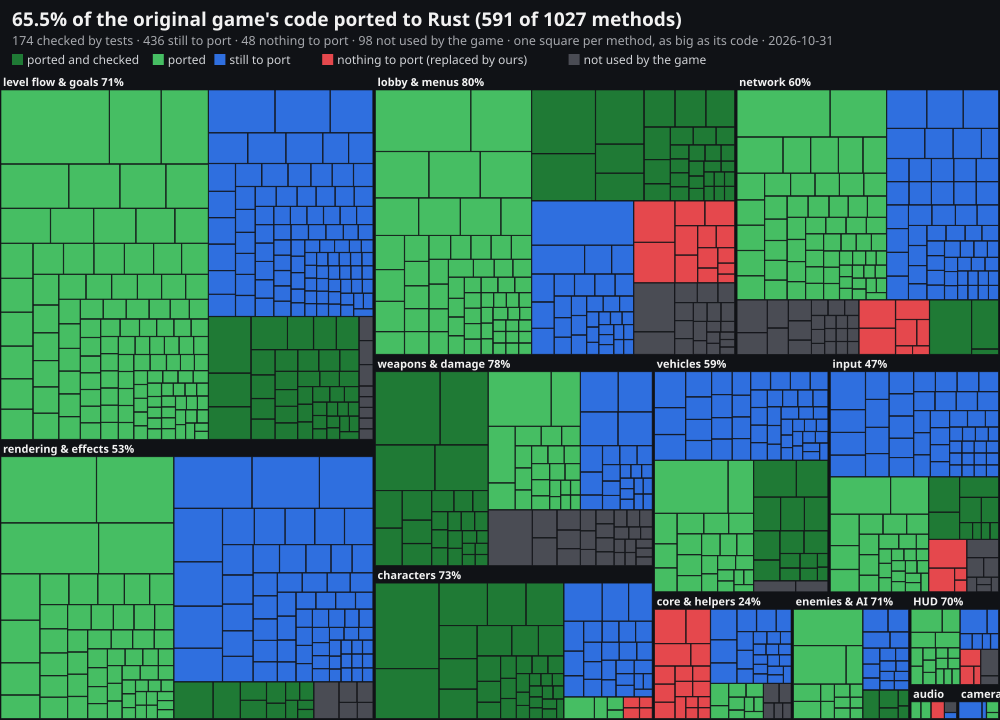
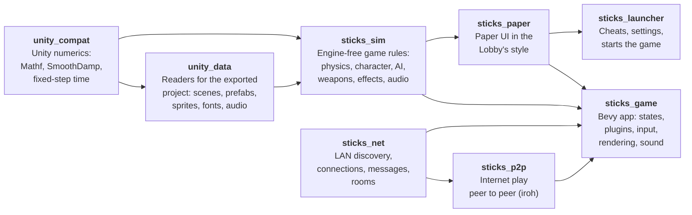

<div align="center">

# Stick 'Em Up 2 — Rust + Bevy

**A behaviour-faithful reimplementation of the 2D stick-figure shooter *Stick 'Em Up 2*, rewritten from scratch in Rust on the Bevy engine.**


</div>

---

The original game was built in Unity 5. This project studies how it *behaves*: its physics, timings, AI, weapons, effects, audio and UI. It then rebuilds those systems as idiomatic Bevy ECS code: plugins, components, resources, messages and system sets. The code is not a line-by-line port. The goal is the same game on the screen, in a codebase designed for Bevy rather than for Unity.

> **No game files are included.** This repository contains only original Rust code. To run it you need your own copy of *Stick 'Em Up 2* [on Steam](https://store.steampowered.com/app/282780); `Setup.bat` exports its data for you (see [Playing](#playing)).

## Download

> [!WARNING]
> **This is a work in progress. It is not finished, and there WILL be bugs.** Levels, vehicles, menus and online play are still being built and fixed: expect missing features, crashes and things that behave differently from the original. Please report what you find in [Issues](../../issues).

Get the latest build from **[Releases](../../releases/latest)**: download `StickEmUp2Rust.zip`, unzip it anywhere (not into the Steam game's folder, which has its own `SEU2.exe`), run `Setup.bat` once, then start `sticks_launcher.exe`. Releases are pre-releases (`v0.x`) until the remake is complete.

## Highlights

- **Unity-exact frame order**: input → fixed steps → role input → characters → camera → present → draw. The physics step length is retuned every frame exactly as the original's `FixedUpdateSynchronizer` does.
- **The original renderer, reproduced**: legacy *Vertex Lit* lighting computed per vertex, gamma-space blending, tk2d sprites (tiled, clipped, parallax), polygon surfaces with soft borders, and projected shadows.
- **Real game data**: levels, sprites, fonts, animations and sounds are read directly from the exported Unity project. There are no placeholder assets.
- **Stick figures from the original rig**: Mecanim animation, root motion and aim IK drive the line-and-sprite figures, which explode into pieces on death.
- **Weapons and projectiles**: charge shots, ricochets, and projectiles that stick into whatever they hit and move with it.
- **Particles and audio**: rocket trails, explosions, fireworks, and a MasterAudio emulation (sound variations, fades, mixer volumes, 3D falloff, music cross-fades).
- **Vehicles**: helicopters fly with the original flight model and enemy AI. Players can board, fly and leave their own.
- **The original lobby**: title screen, control assignment, mode, level and difficulty selection, player slots.
- **Network play with rooms**: LAN games as in the original, plus internet games peer to peer (no server). Hosts create a named room with an optional password and a size; a room page shows who is in it, its room code and a chat, and the host can remove players.
- **A launcher in the game's style**: cheats, settings and your online name on one cardboard screen drawn from the game's own art.

## Status

| Subsystem | State |
| --- | --- |
| Shaders & rendering | 🟢 mostly done |
| Level loading | 🟡 core done; level flow (goals, level end) to do |
| Player physics | 🟢 mostly done |
| Weapons, projectiles & sticking | 🟢 mostly done |
| Particles & FX | 🟢 mostly done |
| Audio | 🟢 mostly done |
| Vehicles | 🟡 helicopters done; cars, rockets, cannons to do |
| UI & lobby | 🟢 mostly done |
| Networking & game loop | 🟡 offline loop done; LAN and peer-to-peer internet rooms implemented, being tested |
| Launcher | 🟡 cheats, settings and name done; gun maker and level editor planned |



One square per method of the decompiled game, sized by its code and grouped by system (regenerate with `python tools/coverage.py --source ../source/Assembly-CSharp --assets ../assets_exported/ExportedProject/Assets --crates crates --out docs --progress ../progress.html`; it matches names, so it is an estimate). The detailed per-feature audit, including every behaviour still marked uncertain, is in [`IMPLEMENTATION_MAP.md`](IMPLEMENTATION_MAP.md).

## Architecture



| Crate | Uses Bevy | Responsibility |
| --- | :---: | --- |
| `unity_compat` | | Unity's math and timing behaviour, reproduced exactly |
| `unity_data` | | Parses the exported Unity project into plain Rust data |
| `sticks_sim` | | The game's rules and geometry, with no engine dependency, so they are unit-tested |
| `sticks_net` | | Network play without the engine: LAN announcements in the original's format, framed connections, the message codec, player slots, rooms |
| `sticks_p2p` | | Internet connections peer to peer through [iroh](https://iroh.computer) (QUIC, hole punching, relays when needed) |
| `sticks_paper` | ✓ | Flat UI built from the Lobby's own font, papers and shadows (launcher, room panel) |
| `sticks_game` | ✓ | The Bevy application: `LevelPlugin`, `PlayerPlugin`, `WeaponPlugin`, `EnemyPlugin`, `HelicopterPlugin`, `VehiclePlugin`, `EffectsPlugin`, `GameAudioPlugin`, `LobbyPlugin`, `HudPlugin`, `NetPlugin`, … |
| `sticks_launcher` | ✓ | The launcher program |

Keeping the rules in `sticks_sim` means behaviour is tested against the original's recovered constants without starting a window.

## Playing

From a release zip (made with `Package.bat`, see [Sharing a build](#sharing-a-build)):

1. Install *Stick 'Em Up 2* in Steam.
2. Run **`Setup.bat`** once. It finds the game in your Steam libraries and exports its art, sounds and levels into `assets_exported\` with [AssetRipper](https://github.com/AssetRipper/AssetRipper) (GPL-3.0, downloaded from its releases on first use, not bundled). If the game is not installed, it says so and offers to open Steam to install or buy it.
3. Start **`sticks_launcher.exe`**, pick cheats and settings, and press **Play**.

### Opening it from Steam

Steam can open the launcher when you press **Play** on *Stick 'Em Up 2*, without changing the game's files: right-click the game in your library, **Properties**, and paste this into **Launch Options** (`Setup.bat` prints the line with your own path):

```
"C:\path\to\sticks_launcher.exe" %command%
```

Steam still counts your play time. `%command%` hands the launcher the original game's command line, so the launcher also shows **Play Original (Unity)** to start the original. To undo it, clear the box. (Unlike replacing the game's exe, this survives "Verify integrity of game files" and game updates.)

## Building from source

**You need** a recent stable Rust toolchain ([rustup.rs](https://rustup.rs)) and your own copy of *Stick 'Em Up 2*, exported to a Unity project (`packaging\Setup.bat` does that from Steam). The game looks for the folder `ExportedProject`, which contains `Assets/` and `ProjectSettings/`.

Tell the game where that folder is, in one of three ways:

```sh
# 1. An environment variable
set STICK_EXPORT_ROOT=C:\path\to\ExportedProject     # Windows (cmd)
export STICK_EXPORT_ROOT=/path/to/ExportedProject    # Linux / macOS

# 2. The first command-line argument
cargo run --release -p sticks_game -- /path/to/ExportedProject

# 3. Placing it in an assets_exported/ExportedProject folder next to the program or the
#    repository (or any folder above them)
```

Then:

```sh
cargo run --release -p sticks_game
```

The game opens on the lobby. To jump straight into a level, pass its scene path as a second argument:

```sh
cargo run --release -p sticks_game -- /path/to/ExportedProject "Assets/Game/Levels/Skyline/Skyline 2.unity"
```

### Launcher

```sh
cargo run --release -p sticks_launcher
```

A cardboard screen in the Lobby's style: switch cheats on (god mode, infinite lives, rapid fire, every weapon, unbreakable helicopters, game speed, unlock all levels), drag the music and sound volume sliders, pick Windowed, Borderless or Fullscreen and vertical sync, and set the name other players see. **Play** starts the game (`SEU2.exe`) from the same folder with those choices. Settings live only here; the game has no settings screen. **Original Game Only** starts the game without any of the additions (cheats, internet play, rooms, room codes). The cheats other than "Unlock All Levels" need a game built with the local `crates/sticks_game/src/hacks.rs` (git-ignored); in a level `F2` lists their keys.

### Playing with friends

**Start Network Game** opens a room: give it a name, an optional password and a size (2–4 players). The square server button in the bottom-left corner opens the online page: **Create a Room**, or join a friend's room by pasting its code. In a room the page shows who is in it, its room code with **Copy Room Code**, the chat and **Leave**; the host can **Kick** players. The host starts the game from the usual screens.

- **Same network**: the room shows up as **Join Game: name 2/4** on the other players' title screens, as in the original.
- **Internet**: peer to peer, no server. The host gives friends the room code (**Copy Room Code**); a friend opens the online page (the server button), pastes it (Ctrl+V) and presses **Join**. A code already on the clipboard also makes the room show up on the title screen while it is open. Connections are direct when both routers allow it, and relayed (encrypted end to end) otherwise. The code is long (64 characters) because it is the host's own address; there is no server to hand out short ones.
- A room with a password asks for it before joining.

### Faster builds (Windows)

- `dev.bat` builds and starts the launcher for testing with Bevy as a DLL and LLVM's linker (`rust-lld`, ships with Rust): after a change only your own code is rebuilt and relinked. Not for sharing.
- `Package.bat` (and `claude_build.bat`) use `rust-lld` too. To use it for plain `cargo` commands, create `.cargo\config.toml` with:

  ```toml
  [target.x86_64-pc-windows-msvc]
  linker = "rust-lld.exe"
  ```
- Debug builds (`cargo run`, no `--release`) and release builds each compile every dependency once and keep it; switching between them is not a rebuild. Excluding `target\`, `%USERPROFILE%\.cargo` and `%USERPROFILE%\.rustup` from Windows Defender's scanning helps a lot.
- The game and launcher take the original game's icon from your `SEU2.exe` when they are built (found in your Steam libraries, or set `STICK_ORIGINAL_EXE`); without it they get the remake's own drawn icon (`tools/make_icons.py`).

### Sharing a build

```sh
Package.bat
```

Builds the release programs and writes `dist\StickEmUp2Rust.zip`: `sticks_launcher.exe`, `SEU2.exe` (the game), `Setup.bat`, `setup.ps1` and a player README. It contains no game files; every player exports their own copy with `Setup.bat`.

### Tests

```sh
cargo test -p unity_compat -p unity_data -p sticks_sim
```

Tests that read the real game data use the same `STICK_EXPORT_ROOT`; set it before running them.

## Controls

| Action | Keys |
| --- | --- |
| Move / walk slowly | `A` `D` / hold `Left Shift` |
| Jump / duck | `Space` / `S` |
| Aim / fire | Mouse / left button |
| Next weapon | `Z` or mouse wheel |
| Enter / leave a vehicle | `E` |
| Fly a helicopter | `W` `A` `S` `D`, mouse to aim, left button to fire |
| Back / pause | `Esc` |
| Debug overlay (colliders, diagnostics) | `F1` |

## Development aids

These are not part of the original game.

- **`F1`** shows collider outlines and a diagnostics line.
- **`STICK_SCRIPT`** drives the game unattended for checks and screenshots. Steps are `;`-separated, written as `<frame> <command>`:
  ```sh
  STICK_SCRIPT="200 shot start; 210 key KeyE down; 212 key KeyE up; 400 shot flying; 420 exit"
  ```
  Commands: `shot`, `key`, `aim`, `mouse`, `click`, `press`, `release`, `damage`, `teleport`, `exit`.

## Principles

1. **Behaviour first.** Timings, constants and update order come from evidence: decompiled scripts and the game's own serialized data.
2. **No invented mechanics.** Anything that can't be determined is marked `TODO(UNCERTAIN)` in the code and listed in the implementation map, so guesses don't spread into other systems.
3. **Bevy-native structure.** There is no "fake Unity" layer. Compatibility code exists only where it reproduces something you can see on screen.

## Legal

This is an unofficial fan project, not affiliated with or endorsed by the creators of *Stick 'Em Up 2*. The repository contains no game code, art, audio or other assets from the original. All of these stay with their owners, and you need your own copy of the game to run this project.
