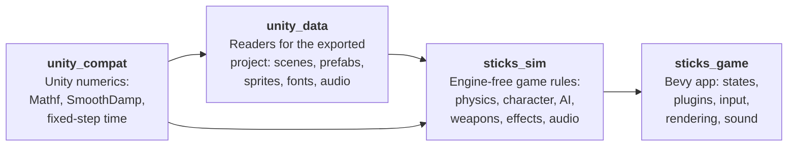

<div align="center">

# Stick 'Em Up 2 — Rust + Bevy

**A behaviour-faithful reimplementation of the 2D stick-figure shooter *Stick 'Em Up 2*, rewritten from scratch in Rust on the Bevy engine.**


</div>

---

The original game was built in Unity 5. This project studies how it *behaves*: its physics, timings, AI, weapons, effects, audio and UI. It then rebuilds those systems as idiomatic Bevy ECS code: plugins, components, resources, messages and system sets. The code is not a line-by-line port. The goal is the same game on the screen, in a codebase designed for Bevy rather than for Unity.

> **No game files are included.** This repository contains only original Rust code. To run it you need your own copy of *Stick 'Em Up 2*, exported to a Unity project folder (see [Running](#running)).

## Highlights

- **Unity-exact frame order**: input → fixed steps → role input → characters → camera → present → draw. The physics step length is retuned every frame exactly as the original's `FixedUpdateSynchronizer` does.
- **The original renderer, reproduced**: legacy *Vertex Lit* lighting computed per vertex, gamma-space blending, tk2d sprites (tiled, clipped, parallax), polygon surfaces with soft borders, and projected shadows.
- **Real game data**: levels, sprites, fonts, animations and sounds are read directly from the exported Unity project. There are no placeholder assets.
- **Stick figures from the original rig**: Mecanim animation, root motion and aim IK drive the line-and-sprite figures, which explode into pieces on death.
- **Weapons and projectiles**: charge shots, ricochets, and projectiles that stick into whatever they hit and move with it.
- **Particles and audio**: rocket trails, explosions, fireworks, and a MasterAudio emulation (sound variations, fades, mixer volumes, 3D falloff, music cross-fades).
- **Vehicles**: helicopters fly with the original flight model and enemy AI. Players can board, fly and leave their own.
- **The original lobby**: title screen, control assignment, mode, level and difficulty selection, player slots.

## Status

| Subsystem | State |
| --- | --- |
| Shaders & rendering | 🟢 mostly done |
| Level loading | 🟡 core done; level flow (goals, level end) to do |
| Player physics | 🟢 mostly done |
| Weapons, projectiles & sticking | 🟢 mostly done |
| Particles & FX | 🟢 mostly done |
| Audio | 🟡 implemented, playback being verified |
| Vehicles | 🟡 helicopters done; cars, rockets, cannons to do |
| UI & lobby | 🟡 main flow done; customisation screens to do |
| Networking & game loop | 🟡 offline loop done; LAN and peer-to-peer internet play implemented, being tested |

The detailed per-feature audit, including every behaviour still marked uncertain, is in [`IMPLEMENTATION_MAP.md`](IMPLEMENTATION_MAP.md).

## Architecture



| Crate | Uses Bevy | Responsibility |
| --- | :---: | --- |
| `unity_compat` | | Unity's math and timing behaviour, reproduced exactly |
| `unity_data` | | Parses the exported Unity project into plain Rust data |
| `sticks_sim` | | The game's rules and geometry, with no engine dependency, so they are unit-tested |
| `sticks_game` | ✓ | The Bevy application: `LevelPlugin`, `PlayerPlugin`, `WeaponPlugin`, `EnemyPlugin`, `HelicopterPlugin`, `VehiclePlugin`, `EffectsPlugin`, `GameAudioPlugin`, `LobbyPlugin`, `HudPlugin`, … |

Keeping the rules in `sticks_sim` means behaviour is tested against the original's recovered constants without starting a window.

## Running

**You need** a recent stable Rust toolchain ([rustup.rs](https://rustup.rs)) and your own copy of *Stick 'Em Up 2*, exported to a Unity project. The game looks for the folder `ExportedProject`, which contains `Assets/` and `ProjectSettings/`.

Tell the game where that folder is, in one of three ways:

```sh
# 1. An environment variable
set STICK_EXPORT_ROOT=C:\path\to\ExportedProject     # Windows (cmd)
export STICK_EXPORT_ROOT=/path/to/ExportedProject    # Linux / macOS

# 2. The first command-line argument
cargo run --release -p sticks_game -- /path/to/ExportedProject

# 3. Placing it at ../assets_exported/ExportedProject next to the repository
```

Then:

```sh
cargo run --release -p sticks_game
```

The game opens on the lobby. To jump straight into a level, pass its scene path as a second argument:

```sh
cargo run --release -p sticks_game -- /path/to/ExportedProject "Assets/Game/Levels/Skyline/Skyline 2.unity"
```

### Launcher

```sh
cargo run --release -p sticks_launcher
```

A cardboard screen in the Lobby's style: switch cheats on (god mode, infinite lives, rapid fire, every weapon, unbreakable helicopters, game speed, unlock all levels), pick the volume, fullscreen and vertical sync, and set the name other players see. **Play** starts `sticks_game` from the same folder with those choices. The cheats other than "Unlock All Levels" need a game built with the local `crates/sticks_game/src/hacks.rs` (git-ignored); in a level `F2` lists their keys.

### Playing with friends

On the same network, one player picks **Start Network Game** and the others see **Join Game** on the title screen, as in the original.

Over the internet the connection is peer to peer (no server): the host presses **Send Link** in the lobby, which copies an invitation (`seu2://<game code>/<name>`) to the clipboard. A friend copies that invitation, and their title screen lists the game while it is open. Connections are direct when both routers allow it, and relayed (encrypted end to end) otherwise.

### Tests

```sh
cargo test -p unity_compat -p unity_data -p sticks_sim
```

Tests that read the real game data use the same `STICK_EXPORT_ROOT`; set it before running them.

## Controls

| Action | Keys |
| --- | --- |
| Move / walk slowly | `A` `D` / hold `Left Shift` |
| Jump / duck | `Space` / `S` |
| Aim / fire | Mouse / left button |
| Next weapon | `Z` or mouse wheel |
| Enter / leave a vehicle | `E` |
| Fly a helicopter | `W` `A` `S` `D`, mouse to aim, left button to fire |
| Back / pause | `Esc` |
| Debug overlay (colliders, diagnostics) | `F1` |

## Development aids

These are not part of the original game.

- **`F1`** shows collider outlines and a diagnostics line.
- **`STICK_SCRIPT`** drives the game unattended for checks and screenshots. Steps are `;`-separated, written as `<frame> <command>`:
  ```sh
  STICK_SCRIPT="200 shot start; 210 key KeyE down; 212 key KeyE up; 400 shot flying; 420 exit"
  ```
  Commands: `shot`, `key`, `aim`, `mouse`, `click`, `press`, `release`, `damage`, `teleport`, `exit`.

## Principles

1. **Behaviour first.** Timings, constants and update order come from evidence: decompiled scripts and the game's own serialized data.
2. **No invented mechanics.** Anything that can't be determined is marked `TODO(UNCERTAIN)` in the code and listed in the implementation map, so guesses don't spread into other systems.
3. **Bevy-native structure.** There is no "fake Unity" layer. Compatibility code exists only where it reproduces something you can see on screen.

## Legal

This is an unofficial fan project, not affiliated with or endorsed by the creators of *Stick 'Em Up 2*. The repository contains no game code, art, audio or other assets from the original. All of these stay with their owners, and you need your own copy of the game to run this project.
